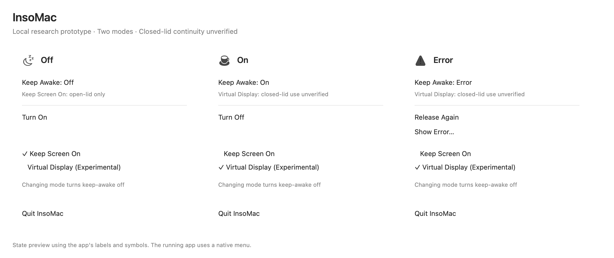

# InsoMac

A small native macOS menu bar prototype for keeping a Mac awake.

| Mode | Current behavior |
| --- | --- |
| **Keep Screen On** | Prevents idle system and display sleep with the lid open. This is the default. |
| **Virtual Display (Experimental)** | Adds a temporary 1280 × 720 secondary display and prevents idle sleep. Uses private macOS interfaces. |

**Closed-lid behavior, physical-panel illumination, and Codex capture/input are unproven.** A virtual display does not establish those capabilities. Existing clients may also fail to discover its mode correctly.

Left-click to toggle. Right-click or Control-click for the menu. Changing mode stops the session and leaves the new mode off. Every launch starts off. State uses distinct symbols and accessibility labels, with an hourglass while work is in progress.

Virtual mode owns a temporary unprivileged process and display; it can affect desktop layout while active. Cleanup includes independent parent-exit monitoring. No accounts, analytics, network calls, third-party dependencies, helper installation, or power-setting changes.

Rendered illustration of the resting states and mode menu. Busy states are omitted; this is not a desktop screenshot:



Build with Xcode 16 or later:

```sh
./scripts/build.sh
open build/InsoMac.app
./scripts/check.sh
```

For headless verification, run `./scripts/check.sh --headless`. [Native CI passed on all four Apple Silicon and Intel macOS 15/26 runners](https://github.com/underconnor/insomac/actions/runs/43563820029), covering core logic, real IOKit assertion cleanup, native executable startup, and candidate packaging. Menu interaction and virtual-display graphics require separate checks.

Targets macOS 13 and later, with `arm64` and `x86_64` builds. Native menu toggles, mode changes, virtual activation, queued Off, and cleanup passed on the local Apple Silicon host. macOS 13 runtime testing remains pending. Private interfaces are checked at runtime and can be unavailable.

The local app uses ad-hoc signing. It has no verified Developer ID signature or notarization and is not a public binary release.

`./scripts/release.sh --mode local-preview --output build/release-candidate` creates a versioned review ZIP, checksums, and release notes. The separate notarized-candidate path rejects missing Developer ID or Keychain prerequisites. See [release preparation](docs/RELEASE.md); a local preview does not complete the unproven product requirements.

`./scripts/test-virtual-display.sh` separately runs bounded creation and cleanup checks, temporarily changing the display list. `./scripts/preview.sh` refreshes light and dark rendered previews. Other developer tools are described in the [implementation notes](docs/IMPLEMENTATION.md).

See [QA evidence and limits](docs/QA.md) and the [MIT license](LICENSE).
